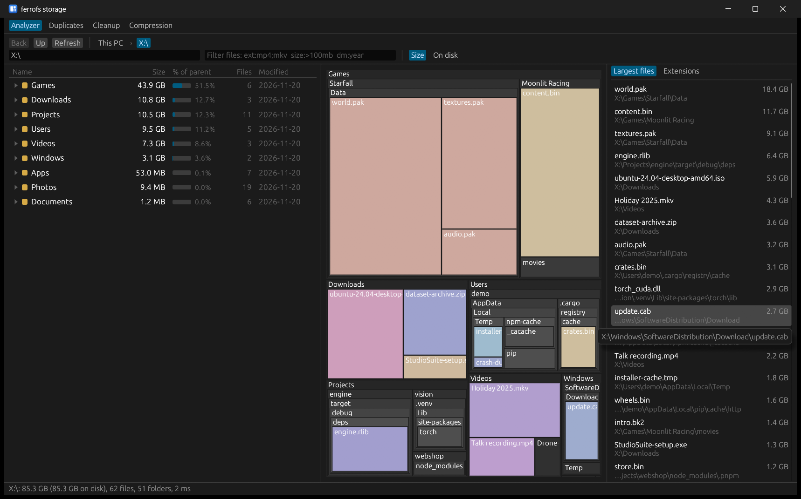
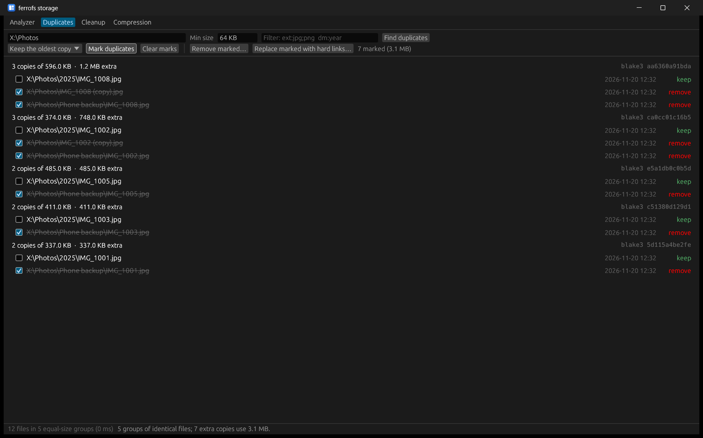
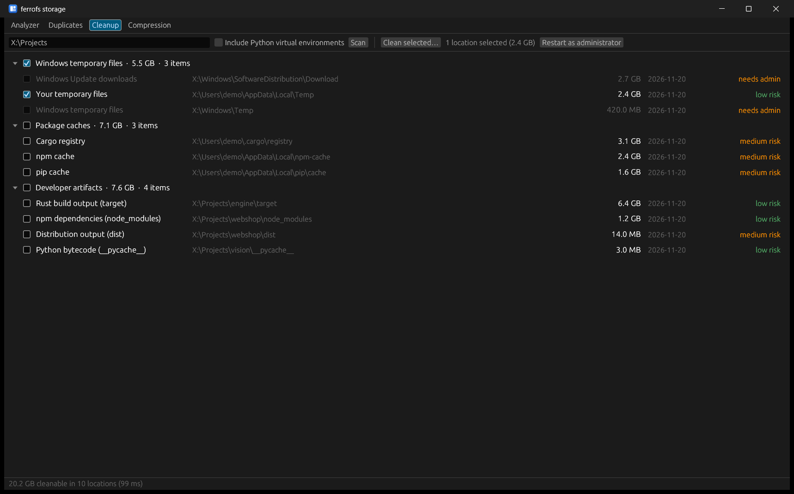
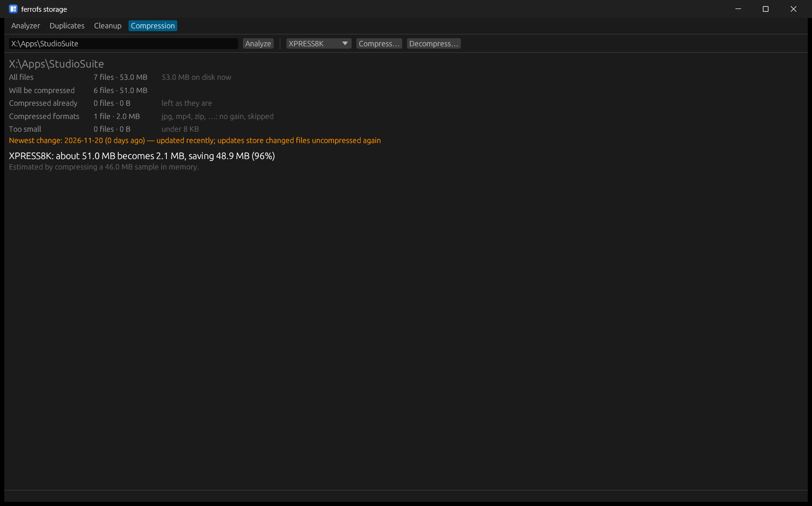

# ferrofs

**Instant file search, disk-space tools and hotkey file linking for Windows — built on the
NTFS Master File Table, written in Rust.**

ferrofs reads the NTFS file table directly instead of crawling folders, keeps it current
from the USN change journal, and answers from memory. Finding a file among two million
takes milliseconds; so does adding up the size of every folder on the disk.



---

## What's inside

| App | What it does |
|---|---|
| **ferrofs search** | A search box on <kbd>Ctrl</kbd>+<kbd>Alt</kbd>+<kbd>Space</kbd>. Results while you type, across every NTFS drive. |
| **ferrofs storage** | Four tools in one window: **Analyzer** (where did the space go?), **Duplicates**, **Cleanup** and **Compression**. |
| **ferrofs link** | Tray app: select files in Explorer, press <kbd>Ctrl</kbd>+<kbd>B</kbd>, go to another folder, press <kbd>Ctrl</kbd>+<kbd>G</kbd> — symlinks, junctions or hard links appear. |
| **ferrofs service** | The indexing engine. Runs in the background as a Windows service and serves the apps. |

## Highlights

- **Fast.** Cold index of 1.9 million entries from the raw MFT in under 3 seconds; restart
  from a snapshot in about half a second; typical queries in 5–40 ms.
- **Always current.** Changes arrive through the USN journal within moments; nothing rescans
  the disk.
- **Safe by design.** Every destructive action has a preview and a dry run, goes to the
  Recycle Bin unless you explicitly choose otherwise, re-checks files right before touching
  them, and is written to an action log.
- **Private.** The index never leaves your machine. File contents are read only by the apps,
  with your own permissions — never by the background service on your behalf.
- **Native and small.** No runtime, no Electron: four Rust executables, a 5 MB installer.

---

## ferrofs search

Press <kbd>Ctrl</kbd>+<kbd>Alt</kbd>+<kbd>Space</kbd> anywhere, type, press <kbd>Enter</kbd>.
Results are ranked by how well the name matches (exact, prefix, word start, anywhere) and by
how often you open them.

| Keys | Action |
|---|---|
| <kbd>Enter</kbd> | Open |
| <kbd>Ctrl</kbd>+<kbd>Enter</kbd> | Show in Explorer |
| <kbd>Ctrl</kbd>+<kbd>C</kbd> | Copy path |
| <kbd>Ctrl</kbd>+<kbd>Shift</kbd>+<kbd>C</kbd> | Copy the file itself (paste it in Explorer) |
| Click the folder column | Copy the folder path |
| <kbd>Esc</kbd> | Hide |

### Query syntax

| Query | Finds |
|---|---|
| `report 2025` | names containing both words (case-insensitive) |
| `invoice \| receipt` | either word |
| `report !draft` | "report" but not "draft" |
| `"annual report"` | the exact phrase |
| `*.toml`, `IMG_????.jpg` | wildcards over the whole name |
| `ext:pdf;docx` | by extension |
| `type:folder`, `type:file` | only folders or files |
| `path:projects\web` | full path contains the text |
| `size:>100mb`, `size:1gb..4gb`, `size:empty` | by size |
| `dm:today`, `dm:week`, `dm:2025-01-01..2025-03-31` | by modification date |
| `re:^IMG_\d{4}\.jpg$` | regular expression |

Case-insensitive matching uses its own Unicode case folding, so results never depend on the
system language (Turkish *İ/ı* included).

---

## ferrofs storage

### Analyzer — where did the space go?

The size of every folder on every drive, computed from the index in about 100 ms (no disk
crawl). A tree table you can expand, a treemap that zooms into folders as you go, the largest
files, a breakdown by extension (click one to filter), logical size or size on disk.

### Duplicates



Candidates come from the index (files of equal size), then contents are compared: first and
last 64 KB with xxh3, then the whole file with BLAKE3. Hard links of the same file are
recognized and never reported. Mark copies by rule (keep oldest, newest or shortest path) or
by hand — at least one copy per group always stays — then move them to the Recycle Bin or
replace them with hard links.

### Cleanup



- **Temporary files:** your temp folder, Windows temp, Windows Update downloads, Delivery
  Optimization, crash dumps.
- **Package caches:** npm, pnpm, Yarn, pip, Cargo, NuGet, Gradle, Maven.
- **Developer build output:** `node_modules`, Rust and Maven `target`, `.gradle`, `build`,
  `dist`, `__pycache__`, Python virtual environments (opt-in). Folders count only next to
  their project file (`package.json` + lock file, `Cargo.toml`, `pom.xml`, …), and never
  inside installed software, so an app's bundled `node_modules` is left alone.

Only your own temp folder is selected by default. Locations under `C:\Windows` are marked
*needs admin*; one click restarts the tool elevated. After a cleanup the tool measures again
and tells you how much was actually freed.

### Compression



Transparent Windows compression (the same WOF mechanism as `compact /exe`) for folders that
rarely change, such as games and installed programs. Files stay readable by every program.
Before anything is changed you get an estimate from a sample compressed in memory, and the
tool suggests large program folders that have not changed in months. Already compressed
files and formats (jpg, mp4, zip, …) are skipped. **Decompress** undoes it.

---

## ferrofs link

| Keys | Action |
|---|---|
| <kbd>Ctrl</kbd>+<kbd>B</kbd> in Explorer | Pick the selected files and folders |
| <kbd>Ctrl</kbd>+<kbd>G</kbd> in another Explorer window | Create links to them here |
| <kbd>Ctrl</kbd>+<kbd>Shift</kbd>+<kbd>G</kbd> | Choose the link type first |

| Link type | Default for | Notes |
|---|---|---|
| Symbolic link | files | Survives "save as new file + rename" editors; needs Developer Mode or admin |
| Junction | folders | No special rights needed; local drives |
| Hard link | opt-in | Same drive only; no extra space |

The hotkeys act only while Explorer or the desktop is in front; everywhere else the keys
work as usual. Works with Windows 11 Explorer tabs.

---

## Install

**Requirements:** Windows 10 1809 or later (Windows 11 recommended), x64, NTFS drives.

### Build the installer

```powershell
# Rust (stable), MSVC Build Tools with the Windows SDK, and Inno Setup 6:
winget install JRSoftware.InnoSetup
.\scripts\build-installer.ps1        # -> dist\ferrofs-setup-<version>.exe
```

Run the setup as administrator. It installs to `C:\Program Files\ferrofs`, registers the
**ferrofs** service (LocalSystem, delayed automatic start), adds Start menu shortcuts and,
if you keep the boxes ticked, starts search and link at sign-in. Uninstalling removes the
service and asks whether to delete the index snapshots.

### Run from source

```powershell
cargo build --release
# elevated shell:
.\target\release\ferro-service.exe install      # or: run --console
.\target\release\ferro-search.exe --show
.\target\release\ferro-storage.exe [folder]     # --duplicates / --cleanup / --compression
.\target\release\ferro-link.exe
```

`ferro-service` also has command-line helpers that talk to the running service: `status`,
`query <text>`, `sizes [folder]`, `dupes [folder]`, `cleanup [folder]`.

### Where things live

| What | Where |
|---|---|
| Settings (`[search]`, `[hotkeys]`, `[link]`) | `%APPDATA%\ferrofs\config.toml` |
| App logs, search history, action log | `%LOCALAPPDATA%\ferrofs\` |
| Index snapshots, service logs | `%PROGRAMDATA%\ferrofs\` (snapshots: SYSTEM and Administrators only) |

---

## Safety and privacy

- **Preview first.** Removing, hard-linking, cleaning and compressing always open a preview
  with *Apply*, *Dry run (log only)* and *Cancel*. `ferro-storage --dry-run` disables Apply
  entirely.
- **Recycle Bin by default.** Permanent deletion is an explicit opt-in per action. If a
  drive has no Recycle Bin, Windows asks before anything is deleted for good.
- **Checked again at the last moment.** A file that changed after it was compared, a kept
  copy that is gone, a project file that disappeared, a folder that became a link — each
  makes the action skip that item. Drive roots and top-level folders are never cleaned.
- **Action log.** Every action, including dry runs, is appended to
  `%LOCALAPPDATA%\ferrofs\actions.jsonl` with enough detail to undo it.
- **Least privilege.** The service only indexes names, sizes and dates and answers queries
  over a named pipe restricted to interactive users; apps accept answers only from a service
  running in session 0. Snapshots (which list every file name) are readable by SYSTEM and
  Administrators only. Hashing and every change to files happen in the apps, with your own
  permissions.

---

## Performance

Measured on a laptop with a 512 GB NVMe SSD and 1.9 million files and folders on `C:`:

| Operation | Time |
|---|---|
| Index from the raw MFT (cold) | 2.5–2.9 s |
| Index via USN enumeration (fallback) | 5.5 s |
| Restart from snapshot + journal replay | ≈ 0.5 s |
| Search query (substring, through the service) | 5–40 ms |
| Size of every folder (`SizeTree` for `C:\`) | ≈ 100 ms |
| Duplicate candidates for the whole drive | ≈ 450 ms |
| Developer artifact scan of the whole drive | ≈ 80 ms |

The index uses about 55 bytes per entry plus the names; ~300 MB for 1.9 million entries.

---

## How it works

```
crates/
├── ferro-core      MFT and USN journal reader, struct-of-arrays index, query engine,
│                   folder totals, duplicate and build-output detection
├── ferro-ipc       versioned postcard protocol over a named pipe
├── ferro-service   Windows service: one index per NTFS volume, live journal, snapshots
├── ferro-search    search window (egui)
├── ferro-storage   analyzer, duplicates, cleanup, compression (egui)
└── ferro-link      tray app, low-level keyboard hook, Explorer selection via COM
```

- The index is a set of flat arrays (parent, name offset, size, date, flags) with one string
  pool, so a scan over two million names is a tight parallel loop with no allocation.
- Folder totals are computed in a few sequential passes plus a pre-order numbering of
  folders, which turns "is this file inside that folder" into two comparisons.
- The journal reader coalesces bursts of changes and re-reads sizes only when a file is
  closed.

## Development

```powershell
cargo fmt --all
cargo clippy --all-targets -- -D warnings
cargo test --workspace
```

Tests that need administrator rights run on a temporary VHD (`tests/fixtures`) via
`scripts/test-elevated.ps1`. UI end-to-end scripts (`scripts/e2e-*.ps1`) drive the real apps
against a fake service that indexes a throwaway folder; they set `FERROFS_DEV_PIPE` so they
never talk to an installed service. `scripts/readme-screenshots.ps1` recreates the pictures
above from a synthetic demo drive.

## Known limitations

- Only NTFS drives are indexed (no FAT/exFAT/ReFS yet).
- A hard-linked file appears under one of its names in search.
- Search by creation or access date (`dc:`, `da:`) is not available yet.
- WSL and Docker virtual disks are listed in Cleanup but not compacted.
- The installer is not code-signed, so SmartScreen may warn when it is downloaded.

## License

[MIT](LICENSE)
